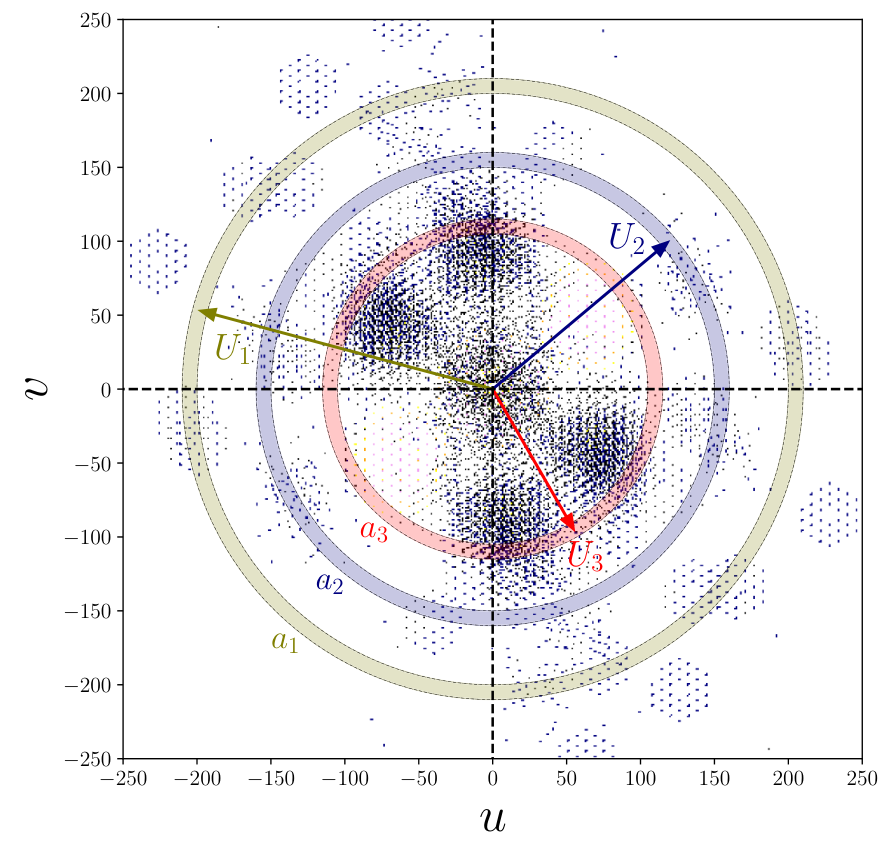

# ViBEr
## Visibility-based angular Bispectrum Estimation using Radio interferometric data. 
### It takes gridded visibility data from a single frequency channel and computes the angular bispectrum by correlating all possible triplets of baselines that form a closed triangle.


[Paper](https://doi.org/10.3847/1538-4357/ad9b20) · [arXiv](https://arxiv.org/abs/2412.02246) · [Installation](docs/INSTALL.md) · [Code review](docs/REVIEW.md)

ViBEr estimates the binned **single-frequency angular bispectrum** from gridded radio-interferometric visibilities. FFTs of visibility and sampling grids restricted to annular rings accelerate the sum over closed baseline triangles. The archive also includes a non-Gaussian sky generator, visibility simulation using an existing UVFITS template, and visibility gridding.

**Build checked:** the selected root Makefile targets compile on Linux/GCC; compiler warnings and runtime issues remain. See [build log](docs/build.log).

**Status:** documented research-code snapshot. The supplied pipeline is incomplete without an external UVFITS template and has a blocking array-allocation bug in `viber.c`. See [REVIEW.md](docs/REVIEW.md) before running. This package does not calibrate raw telescope data, remove foregrounds, or directly estimate the 3D frequency-dependent bispectrum; the latter is AMBER's purpose.


*Figure 1 of arXiv:2412.02246v2: baseline sampling and annular-ring construction. [Attribution](docs/figures/ATTRIBUTION.md).*

## Method in brief

Baselines and angular Fourier modes obey $\boldsymbol\ell=2\pi\mathbf U$. For ring $a$, define a Fourier-transformed data grid $D_a$ and its sampling counterpart $I_a$. The FFT estimator forms

$$\widehat B_{\rm vis}\propto\frac{\sum_{\boldsymbol\theta}D_{a_1}(\boldsymbol\theta)D_{a_2}(\boldsymbol\theta)D_{a_3}(\boldsymbol\theta)}{\sum_{\boldsymbol\theta}I_{a_1}(\boldsymbol\theta)I_{a_2}(\boldsymbol\theta)I_{a_3}(\boldsymbol\theta)}.$$

The proportionality reminds users that FFT and beam/brightness-temperature factors must be applied consistently. For closed triangles, the paper's Gaussian-beam, large-baseline approximation gives

$$\langle V_1V_2V_3\rangle\simeq\frac{\pi\theta_0^2 Q^3}{3} B(\ell_1,\ell_2,\ell_3),\qquad Q=2k_B/\lambda^2.$$

The approximation requires baselines large compared with the inverse beam width. The paper's tests use simulated MWA sampling at 154.25 MHz and omit system noise; do not interpret the paper's validation accuracy as a guarantee for an arbitrary dataset.

Triangle shapes use $t=\ell_2/\ell_1$ and $\mu=-\hat\ell_1\cdot\hat\ell_2$ with ordered lengths, $1/2\le\mu,t\le1$, $2\mu t\ge1$.

## Installation

```bash
sudo apt install build-essential libfftw3-dev libgsl-dev libcfitsio-dev
# After publication:
git clone https://github.com/sukhdeepsinghgill/ViBEr.git
cd ViBEr
make
```

Builds `1_ngrf/ngrf_2d`, `2b_visfitsgrid/visfitsgrid`, `3_vcg/vcg`, `4_fbe/viber`, and `4_fbe/viber_equi_fast`. Use the **root** Makefile; the old stage defaults can remove executables or refer to absent files. Optional notebook dependencies and custom-prefix setup are in [INSTALL.md](docs/INSTALL.md).

## Pipeline and inputs

| Stage | Input | Output |
|---|---|---|
| `1_ngrf/` | Simulation parameters | Sky-temperature and beam-weighted intensity FITS images |
| `2b_visfitsgrid/` | Image plus existing UVFITS sampling template | Modified copy of UVFITS containing simulated visibilities |
| `3_vcg/` | Compatible UVFITS and `inputparameters` | Gridded complex visibility file and sampling file |
| `4_fbe/` | Visibility grid plus sampling, with matching geometry | Angular bispectrum and power-spectrum tables |

`2a_MWA_baselines/` was empty. The required `single_chan.fits` template is absent. Supply a compatible **one-channel** random-groups UVFITS file, with the baseline/polarization/header conventions expected by the reader. A CASA Measurement Set is not accepted directly. Always pass a copy of the template to `visfitsgrid`: it edits that file in place.

## One-realization workflow

These are the actual command interfaces, conditional on supplying the template and resolving the review blockers. The original batch scripts use inconsistent ranges, so start with one realization.

```bash
# From repository root, after make. Supply this file yourself:
# 2b_visfitsgrid/single_chan.fits
(
  cd 1_ngrf
  mkdir -p output_data
  ./ngrf_2d 4096 1.719 100513 0.00025 0.8 154.255e6 40000 1 1 \
    output_data/image_T_1c_1.FITS output_data/image_Q.beam.In_1c_1.FITS 1
)
(
  cd 2b_visfitsgrid
  mkdir -p data
  cp single_chan.fits data/single_chan_1.fits
  ./visfitsgrid ../1_ngrf/output_data/image_Q.beam.In_1c_1.FITS data/single_chan_1.fits 0
)
(
  cd 3_vcg
  mkdir -p output_data
  ./vcg ../2b_visfitsgrid/data/single_chan_1.fits inputparameters output_data/GV_data_1 1 output_data/sampling
)
(
  cd 4_fbe
  mkdir -p results
  ./viber 1 GV_data_1
)
```

The 4096² simulation is the archived configuration, not a tiny smoke test. Validate its RAM requirement locally. The last generator argument is the realization identifier, although its usage message omits this argument. `visfitsgrid ... 0` overwrites the copied template's visibility contribution; `1` adds to it.

For already-gridded data, start at the last step **only** if its binary layout, sampling and geometry exactly match this reader. `GV_data_1` is a basename, not a full path: the estimator prepends `../3_vcg/output_data/`.

## Adjustable parameters

| Parameter | Location | Current setting / meaning |
|---|---|---|
| `Nx`, pixel size | Generator CLI | `4096`, `1.719` arcmin |
| Seed, `ff`, spectral index | Generator CLI | `100513`, `0.00025`, `0.8` in the example |
| Frequency, channel width | Generator CLI | Hz; `154.255e6`, `40000` |
| Reference channel, channel count | Generator CLI | `1`, `1` for this workflow |
| Channel count, maximum baseline | `3_vcg/inputparameters` | `1`, `602` wavelengths |
| Beam FWHM, taper parameter | `3_vcg/inputparameters` | `1480.73` arcmin, `1.0`; inspect active gridding routine before assuming a changed taper is applied |
| `N1`, `N2`, `Du` | `4_fbe/viber.c` | `1176`, `1176`, `1.0254384902642049`; must match generated grid |
| Ring count and edges | `viber.c` | `Nbin=25`, piecewise interval construction |
| Threads | `viber.c` | `Nthreads=4` |
| `F_Task` | `viber.c` | `1` computes spectra; `0` selects geometry output |
| PS bins/range | `viber.c` | `NB=15`, `Umin1=1`, `Umax1=500`; **NB is assigned after allocation: fix ordering first** |
| Test prediction | `viber_funcs.c:P_T` | Analytic model; not a fit to an arbitrary observed sky |

Recompile after C edits. Keep the grid size, spacing, baseline cuts and sampling file synchronized. A single sampling file can only be reused when the sampling is actually identical. Independent runs should have separate working directories because intermediate filenames are shared.

## Binary input and outputs

The active visibility reader expects headerless, native-double pairs `(real, imaginary)` for each `(i,j,channel)`, with `i=0..N1-1`, `j=0..N2/2`, channel innermost. The sampling file contains one native double per corresponding cell/channel. This is a local format, **not** AMBER's header-bearing format.

`results/bsout_GV_data_1` has seven columns:

| Column | Meaning |
|---|---|
| 1 | Largest-ring index |
| 2–3 | `t`, `mu` |
| 4 | Raw FFT-ratio bispectrum output |
| 5 | Analytic model comparison `Biana` |
| 6 | `100*(abs(Bispec)-Biana)/Biana` |
| 7 | Sampling normalization interpreted as triangle count by the implementation |

Do not label column 4 as a calibrated brightness-temperature bispectrum without checking the beam/Q normalization in the analysis. `results/psout_GV_data_1` contains mean baseline, power estimate and mode count. `modes`, `shape_u*` and `masked_*` are intermediate geometry/cache products.

## Analysis and provenance

Recovered notebook sources are in `legacy_notebooks/`; they were only present as checkpoints in the archive and are not validated tutorials. Some import a missing `cldnufuncs` module. The equilateral implementation is an alternative research path, not a substitute for checking the general estimator.

See [PACKAGING.md](docs/PACKAGING.md) for the exact packaging changes, [CONTRIBUTING.md](CONTRIBUTING.md) for support, and [LICENSE_STATUS.md](LICENSE_STATUS.md) for the pending license decision. Existing source-level credits have been preserved.

## Cite

Sukhdeep Singh Gill, Somnath Bharadwaj, Sk. Saiyad Ali and Khandakar Md Asif Elahi, *A visibility-based angular bispectrum estimator for radio-interferometric data*, [doi:10.3847/1538-4357/ad9b20](https://doi.org/10.3847/1538-4357/ad9b20). Machine-readable paper citation: `CITATION.cff`.
